

# RaceDeck

**Le tableau de bord gratuit des DS sur Zwift.**
Tes coureurs, les écarts, la puissance et le parcours en direct, au-dessus de Zwift… et maintenant sur ton téléphone.

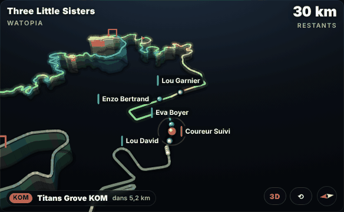

---

## 🆕 Nouveau dans la 0.10.39

- 📱 **Companion complet** : caméras, Ride On à l'équipe, message privé à toute l'équipe, compte à rebours avant chaque bloc, résumé de séance, vue stream OBS, raccourcis clavier
- 🌐 **RaceDeck Live relié** : tes sorties RaceDeck PC arrivent sur ton téléphone, et un seul compte observateur suffit pour les deux
- ☑️ **Modules à la carte** : coche-les, puis affiche ou masque seulement ta sélection
- ⌨️ La touche **Suppr** (⌫ sur Mac) supprime un module, avec **Annuler**
- 🍏 **Mac (bêta)** : même release et mêmes mises à jour automatiques que Windows

---

## 🗺️ La Carte 3D

Une mini-carte à la place de celle de Zwift : le parcours en relief, coloré selon la pente, tes coureurs et la tête du pen, les sprints et KOM qui arrivent.
Molette pour zoomer, glisser pour déplacer, clic droit pour tourner, bouton **2D / 3D**.

| Suivi du coureur | Vue du dessus | Tout le parcours |
|:---:|:---:|:---:|
| 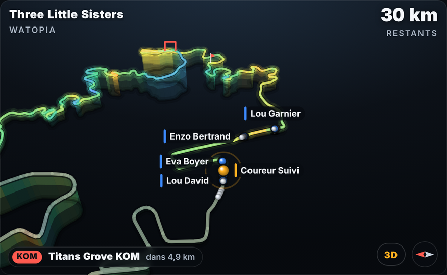 | 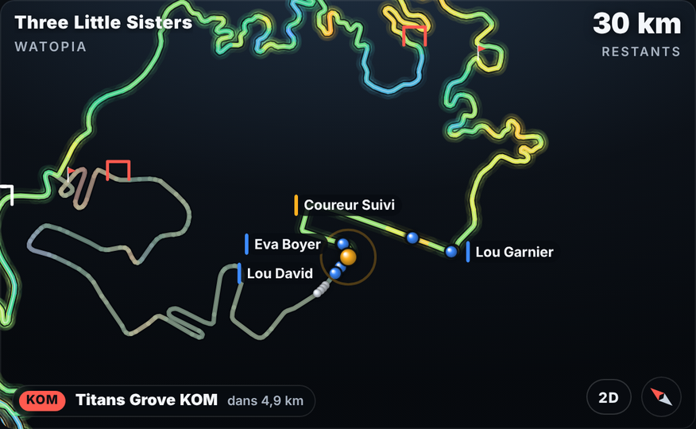 | 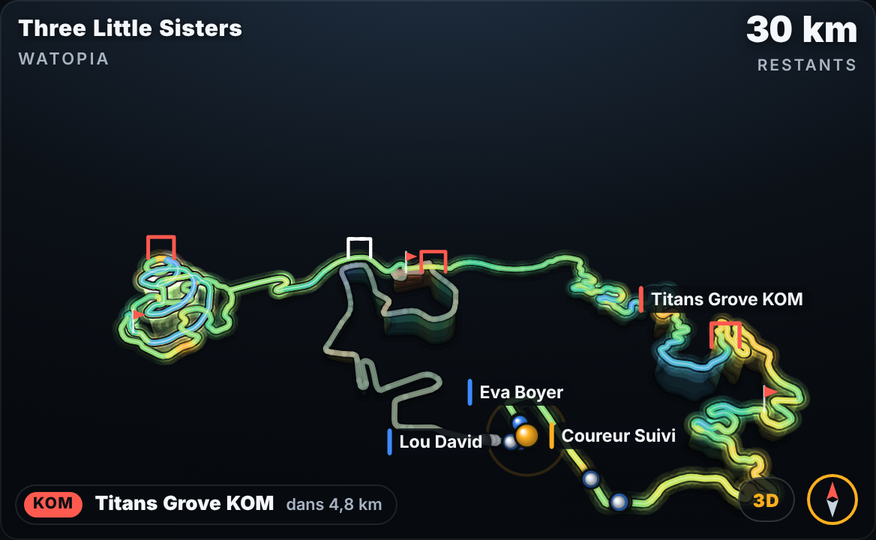 |

## 🪟 Des modules au-dessus de Zwift

Chaque module est une petite fenêtre transparente que tu places où tu veux. Cadenas fermé : les clics passent à Zwift.

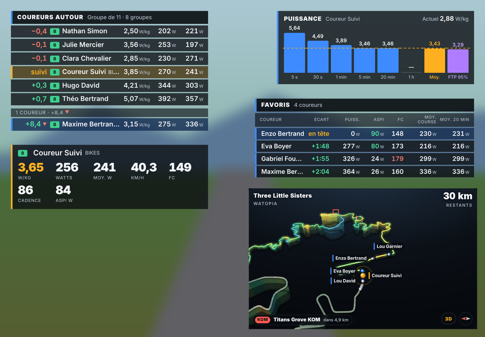

**Coureurs autour** · **Compteur** · **Équipe** · **Favoris** · **Stats puissance** (avec FTP 95 %) · **Carte 3D** · **Parcours** · **Écarts TV** · **Groupes** · **Alertes DS** · **Companion**

☑️ Choisir les modules à afficher

 
Coche les modules voulus, puis <b>👁 Afficher la sélection</b> ou <b>🙈 Masquer la sélection</b>.
Un module déverrouillé se supprime avec la touche <b>Suppr</b> (⌫ sur Mac), avec <b>↶ Annuler</b> pendant 6 s.
  
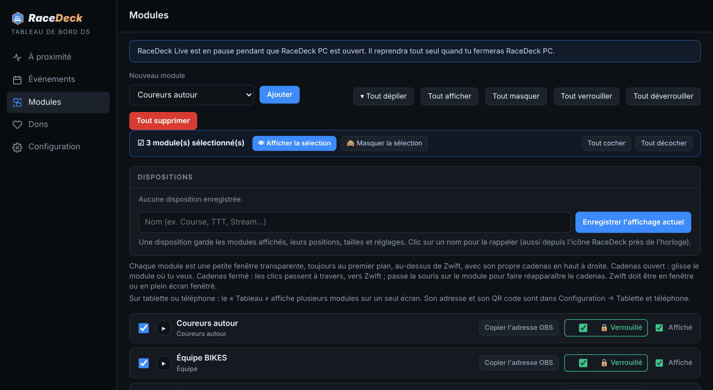

## 📱 Le module Companion

Ton entraînement, le parcours et le chat, avec les commandes du jeu, sans quitter Zwift.

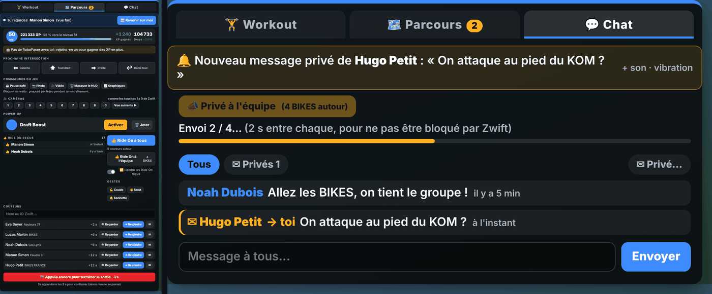

- 🗺️ **Parcours** : prochain virage, power-up (activer / jeter), caméras, 🔙 revenir sur moi, 🏁 terminer la sortie (double appui)
- 👍 **Ride On** à tous ou **à l'équipe seulement**, et 🔁 Ride On rendus automatiquement
- 💬 **Chat** : message privé à un coureur ou 📣 **à toute l'équipe**, 🔔 alerte quand tu en reçois un
- 📺 **Vue stream** pour OBS, sans boutons
- ⌨️ **Raccourcis clavier** réglables, qui marchent même quand Zwift est au premier plan (aussi avec un Stream Deck)

🏋️ Entraînement : compte à rebours et résumé de séance

 
Bloc en cours, cible en watts, jauge, ⏱️ <b>compte à rebours 3 s</b> avant chaque changement de bloc (bip et vibration), puis 📊 <b>résumé de fin de séance</b> : temps dans la cible, moyenne et étoiles.
  
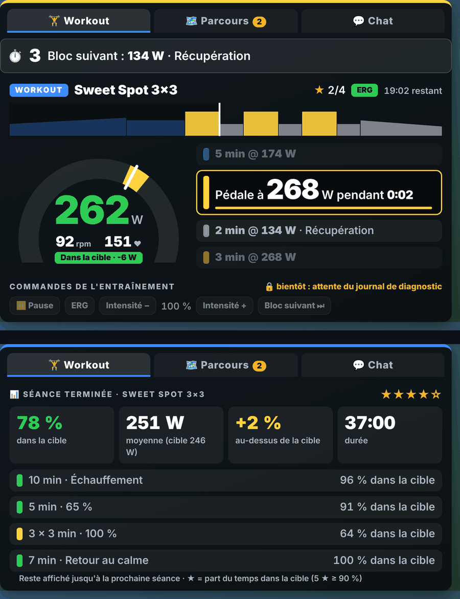

## 🌐 RaceDeck Live : ton téléphone, même sans PC

La version hébergée par le club. Elle s'installe sur l'écran d'accueil du téléphone comme une appli.

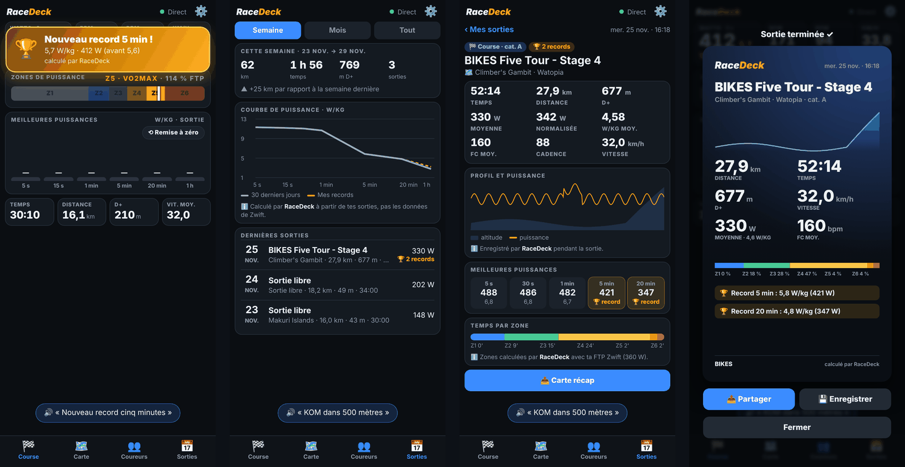

- 🏁 **Course · 🗺️ Carte · 👥 Coureurs · 📅 Sorties**
- 🏆 **Records en direct**, 💪 nouvelle FTP, 📸 **carte récap** à partager
- 🔊 **Annonces vocales** (voix femme ou homme) : KOM, sprint, arrivée, records
- 📊 Courbe de puissance, zones et profil de chaque sortie, **calculés par RaceDeck**

💻 Relier RaceDeck PC et RaceDeck Live

 
Sur le portail : <b>Mon compte → Relier RaceDeck PC</b>, puis tape le code dans RaceDeck PC (<b>Configuration → 🌐 RaceDeck Live</b>).
<ul>
<li>Tes sorties faites avec RaceDeck PC arrivent dans l'onglet 📅 Sorties, avec l'étiquette 💻 PC.</li>
<li>Un seul compte observateur pour les deux : quand RaceDeck PC est ouvert, le Live se met en pause tout seul.</li>
</ul>
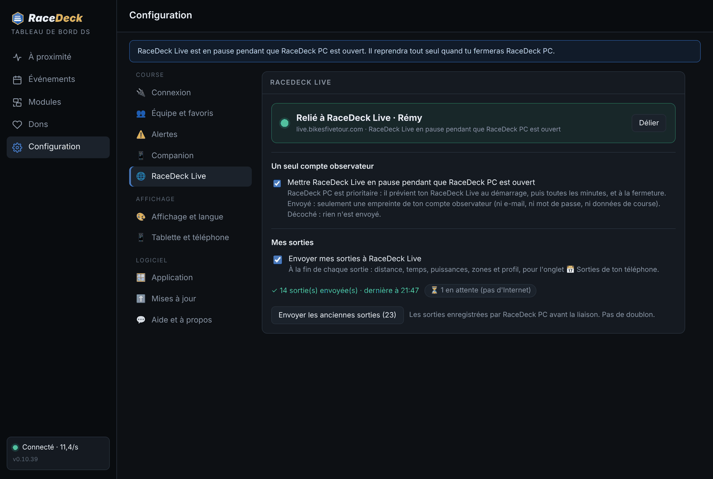

## 🖥️ L'application

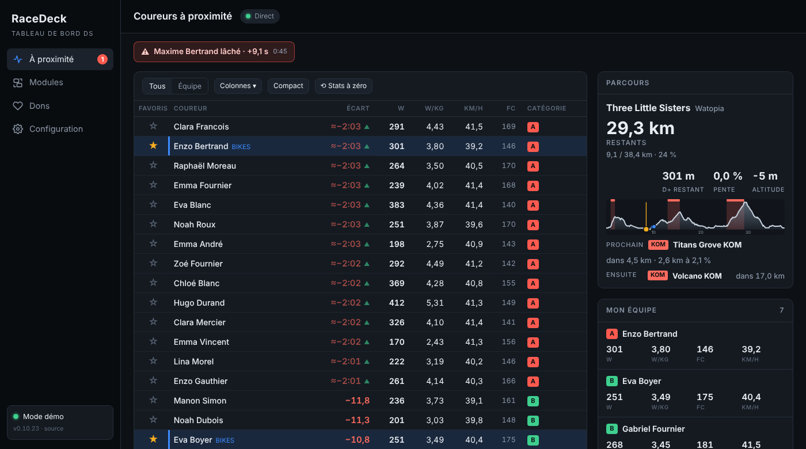

- **À proximité** : tous les coureurs autour, ☆ pour tes favoris, clic sur un nom pour sa fiche
- **Stats remises à zéro au départ** : l'échauffement dans le sas ne compte pas
- **6 thèmes** de couleur, en français et en anglais
- **Téléphone, tablette et OBS** : chaque module a son adresse
- **Mises à jour automatiques** et **mods** à installer en .zip

🎨 Voir les thèmes

 
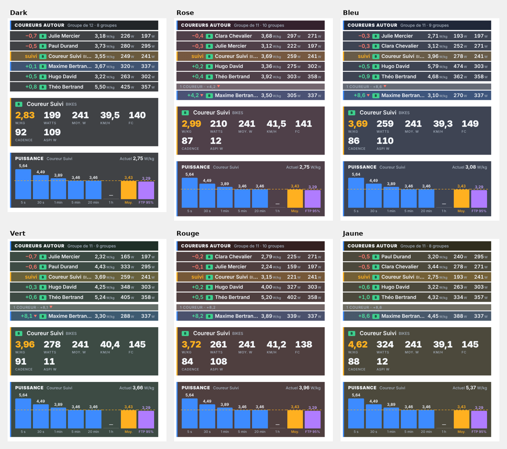

---

## 📥 Installation

### 🪟 Windows
1. Télécharge **`RaceDeck-x.y.z-Windows.zip`** dans la [dernière version](https://github.com/monnierremy70/racedeck/releases/latest).
2. **Clic droit → Extraire tout**, puis lance **`RaceDeck.exe`**.
3. Au premier lancement, fais ta **demande de clé** (gratuite, une par PC) et colle la clé reçue.

> Si Windows affiche « Windows a protégé votre ordinateur » : **Informations complémentaires → Exécuter quand même**.

### 🍏 Mac (bêta)
1. Télécharge **`RaceDeck-mac-x.y.z.zip`** dans la [dernière version](https://github.com/monnierremy70/racedeck/releases/latest).
2. Ouvre **`INSTALLER_MAC.command`** et suis **`LISEZ_MOI_MAC.txt`**.

**Il te faut :** un PC Windows 10 ou 11 (ou un Mac), un **second compte Zwift « observateur »** (gratuit, une autre adresse e-mail) et l'**ID Zwift** du coureur à suivre (le nombre dans l'adresse de son profil ZwiftPower).

Pour essayer sans course : **Configuration → Connexion → Mode démo**.

❓ Questions fréquentes

- **« Session en conflit » / « connexion multiple »** : le compte observateur est ouvert ailleurs (Zwift, un autre outil, un autre PC…). Ferme-le. Avec RaceDeck Live, rien à faire : RaceDeck PC prend la main et le Live se met en pause.
- **Le téléphone n'ouvre pas la page** : même Wi-Fi que le PC (pas un Wi-Fi invité), et autorise RaceDeck dans le pare-feu.
- **Un module bloqué ou introuvable** : clic droit sur l'icône RaceDeck près de l'horloge.
- **Un bug, une idée** : Configuration → Aide et à propos.

🔒 Confidentialité

Le compte observateur sert **seulement à lire** les données de course.
Le module **Companion** (facultatif) se connecte au jeu sur **ton** PC pour envoyer les commandes que tu choisis : Ride On, power-up, caméra, chat…
Le mot de passe n'est gardé que si tu coches « Rester connecté ». Il est chiffré par Windows (ou le Trousseau du Mac) et n'est envoyé qu'à Zwift.
Vers RaceDeck Live, il n'y a qu'une **empreinte** du compte observateur (jamais d'e-mail ni de mot de passe) et, si tu l'as relié, le résumé de tes sorties.
Les mises à jour sont signées.

---

**Gratuit** · un onglet **Dons** existe dans l'application pour soutenir le projet.

Créé par **Rémy Monnier** · Team BIKES FRANCE
Licence [GNU GPL v3](LICENSE) · Connexion Zwift d'après [Sauce for Zwift](https://github.com/SauceLLC/sauce4zwift) (GPL-3.0) · Routes [zwift-data](https://github.com/andipaetzold/zwift-data) (MIT) · Electron (MIT)

RaceDeck n'est pas affilié à Zwift, Inc.

