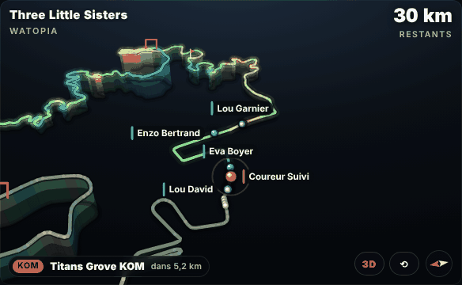
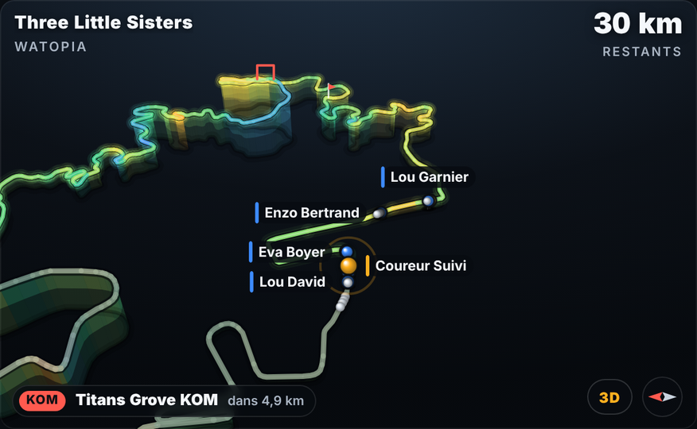
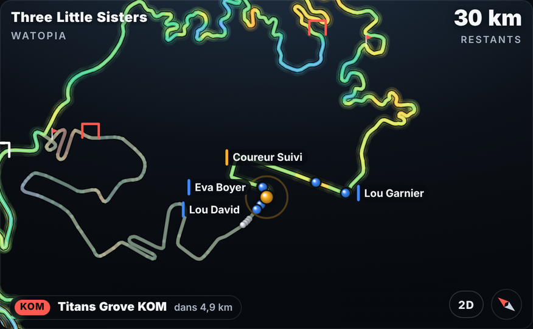
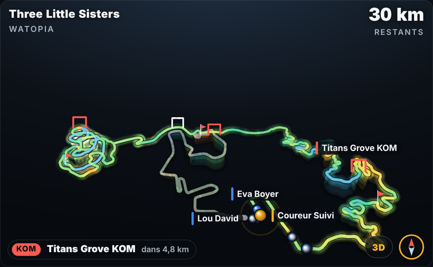
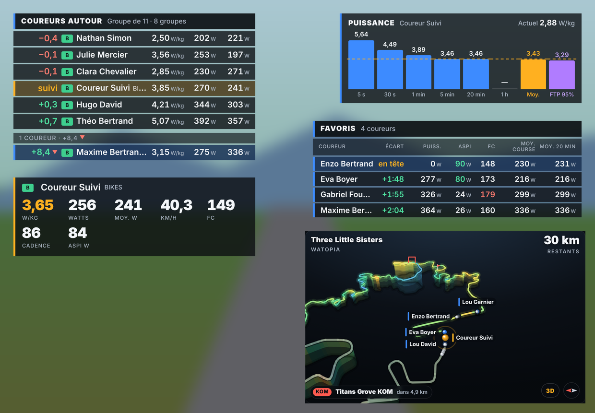
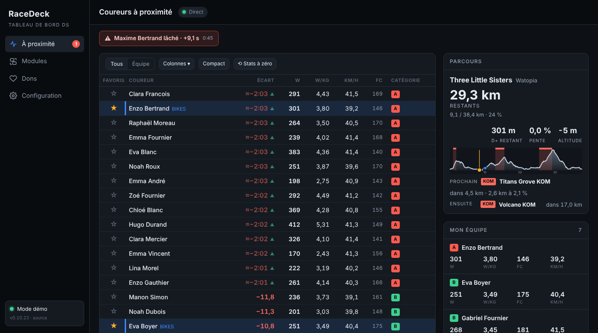
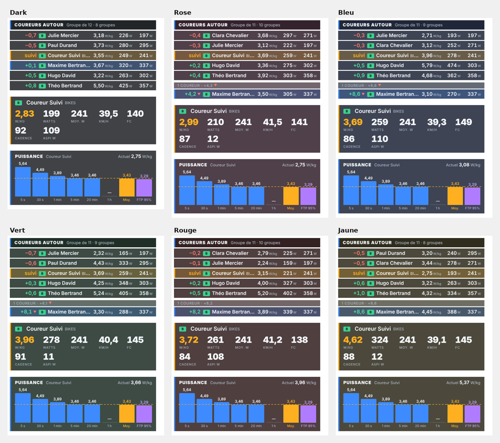

# RaceDeck

**Le tableau de bord gratuit des DS sur Zwift.**
Tes coureurs, les écarts, la puissance et le parcours en direct, au-dessus de Zwift.

---

## 🗺️ La Carte 3D

Une mini-carte à la place de celle de Zwift : le parcours en relief, coloré selon la pente, tes coureurs et la tête du pen, les sprints et KOM qui arrivent.
Molette pour zoomer, glisser pour déplacer, clic droit pour tourner, bouton **2D / 3D**.

| Suivi du coureur | Vue du dessus | Tout le parcours |
|:---:|:---:|:---:|
|  |  |  |

## 🪟 Des modules au-dessus de Zwift

Chaque module est une petite fenêtre transparente que tu places où tu veux. Cadenas fermé : les clics passent à Zwift.

**Coureurs autour** · **Compteur** · **Équipe** · **Favoris** · **Stats puissance** (avec FTP 95 %) · **Carte 3D** · **Parcours** · **Écarts TV** · **Groupes** · **Alertes DS**

## 🖥️ L'application

- **À proximité** : tous les coureurs autour, ☆ pour tes favoris, clic sur un nom pour sa fiche
- **Stats remises à zéro au départ** : l'échauffement dans le sas ne compte pas
- **6 thèmes** de couleur, en français et en anglais
- **Téléphone, tablette et OBS** : chaque module a son adresse
- **Mises à jour automatiques** et **mods** à installer en .zip

🎨 Voir les thèmes

 

---

## 📥 Installation

1. Télécharge **`RaceDeck-x.y.z-Windows.zip`** dans la [dernière version](https://github.com/monnierremy70/racedeck/releases/latest).
2. **Clic droit → Extraire tout**, puis lance **`RaceDeck.exe`**.
3. Au premier lancement, fais ta **demande de clé** (gratuite, une par PC) et colle la clé reçue.

> Si Windows affiche « Windows a protégé votre ordinateur » : **Informations complémentaires → Exécuter quand même**.

**Il te faut :** un PC Windows 10 ou 11, un **second compte Zwift « observateur »** (gratuit, une autre adresse e-mail) et l'**ID Zwift** du coureur à suivre (le nombre dans l'adresse de son profil ZwiftPower).

Pour essayer sans course : **Configuration → Connexion → Mode démo**.

❓ Questions fréquentes

- **« Session en conflit »** : le compte observateur est ouvert ailleurs (Zwift, Companion…). Ferme-le.
- **Le téléphone n'ouvre pas la page** : même Wi-Fi que le PC (pas un Wi-Fi invité), et autorise RaceDeck dans le pare-feu.
- **Un module bloqué ou introuvable** : clic droit sur l'icône RaceDeck près de l'horloge.
- **Un bug, une idée** : Configuration → Aide et à propos.

🔒 Confidentialité

RaceDeck **lit seulement** les données de course avec le compte observateur : il ne pilote rien dans Zwift.
Le mot de passe n'est gardé que si tu coches « Rester connecté », chiffré par Windows, et n'est envoyé qu'à Zwift.
Les mises à jour sont signées.

---

**Gratuit** · un onglet **Dons** existe dans l'application pour soutenir le projet.

Créé par **Rémy Monnier** · Team BIKES FRANCE
Licence [GNU GPL v3](LICENSE) · Connexion Zwift d'après [Sauce for Zwift](https://github.com/SauceLLC/sauce4zwift) (GPL-3.0) · Routes [zwift-data](https://github.com/andipaetzold/zwift-data) (MIT) · Electron (MIT)

RaceDeck n'est pas affilié à Zwift, Inc.

